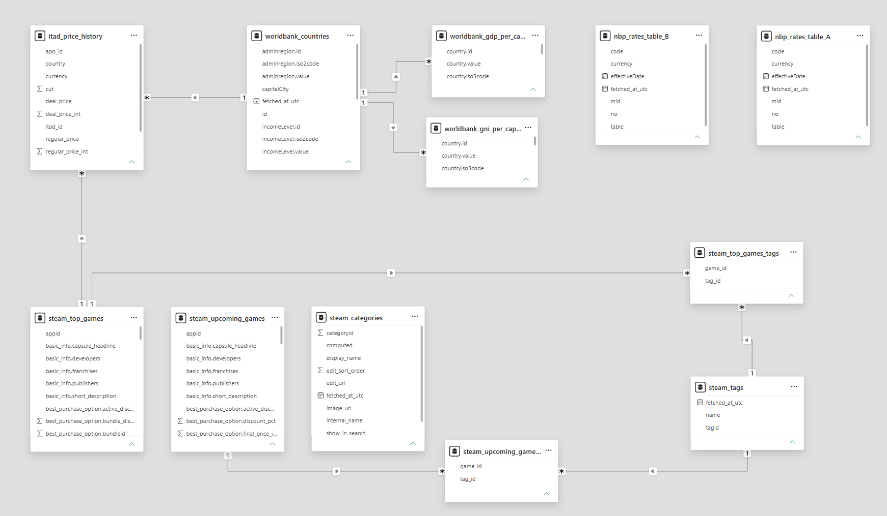

## Kacper:
- znalezienie danych
- scraping danych 
- wstępne przetworzenie danych: usunięcie duplikatów z gier steam, przetworzenie jsona z ITAD do csv, stworzenie tabel steam_top_games_tags i steam_upcoming_games_tags, utworzenie relacji: 
